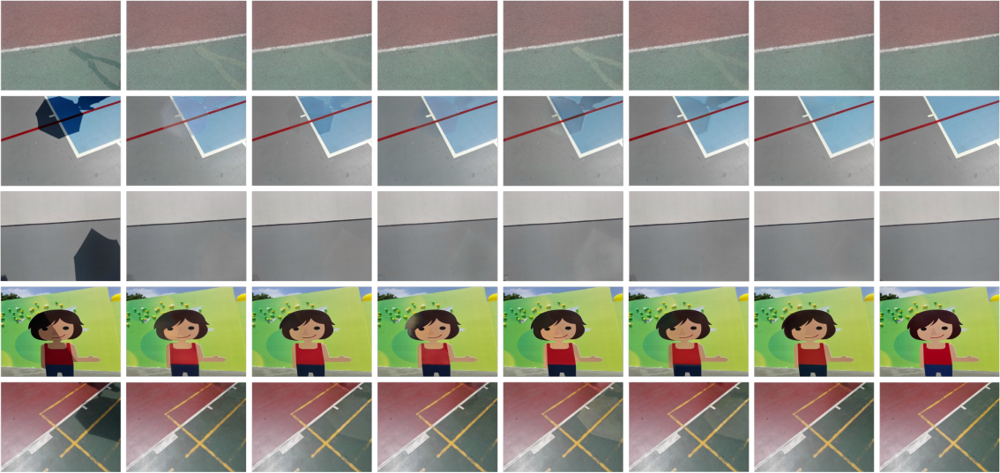
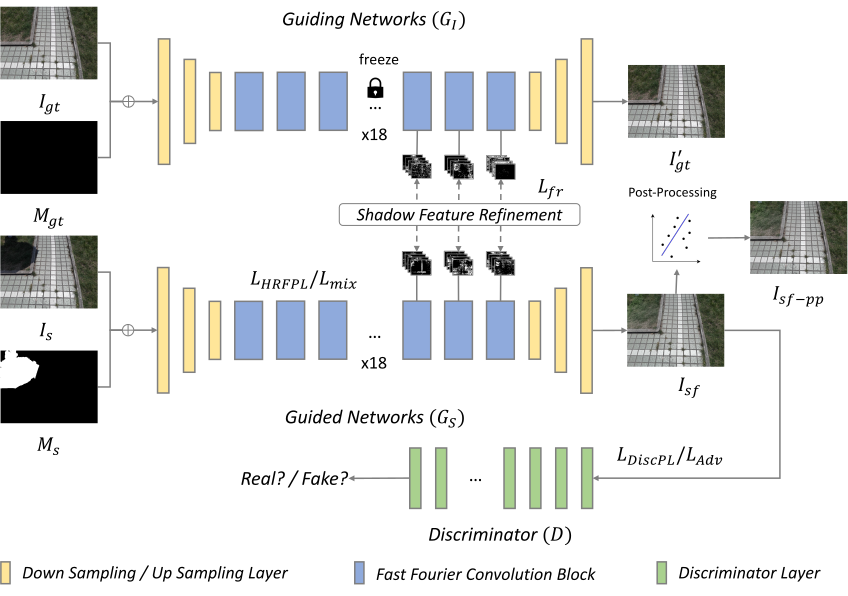
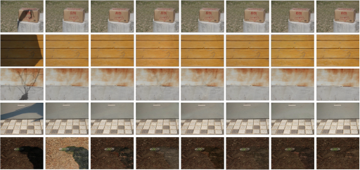

<div align="center">

# Shadow Feature Refinement Network: Progressive Feature Refinement based on Knowledge Distillation for Effective Shadow Removal

**[Donghyun Han](https://donghyun99.github.io/cv/)**<sup>1</sup>, **Byoung-dai Lee**<sup>1\*</sup>

<sup>1</sup>Kyonggi University, South Korea

<sup>\*</sup>Corresponding author

**[Multimedia Systems](https://link.springer.com/journal/530) 31, 449 (2025)**

[](https://arxiv.org/abs/2610.05325)
[](https://doi.org/10.1007/s00530-025-02036-5)
[](https://huggingface.co/Donghyun99/SFRNet)
[](https://donghyun99.github.io/SFRNet/)

</div>

## ✨ TL;DR

SFR-Net removes shadows by treating them as a mask-guided restoration problem on top of a pretrained inpainting
network (LaMa), and **distills the features of a frozen network that sees the shadow-free image** into the network
that sees the shadow image. A lightweight linear-regression post-processing then restores the global colors.

<p align="center">
  <a href="assets/figures/fig4.pdf"></a>
</p>
<p align="center"><sub>Qualitative comparison on ISTD+. Columns from left to right: input, ShadowDiffusion, HomoFormer, ShadowFormer, BMNet, <b>SFR-Net (ours)</b>, InstanceShadowDiffusion, ground truth.</sub></p>

Our contributions:

- 🧠 **Feature refinement by knowledge distillation.** A frozen guiding network G_I reconstructs the shadow-free
  image, and the feature refinement loss L_fr aligns the deep FFC features of the guided network G_S with those
  of G_I, so G_S learns shadow-free representations directly in feature space.
- 🎨 **Color restoration post-processing.** A per-channel linear regression fitted on the non-shadow region aligns
  the output colors with the input image at a cost of under 0.07 s per image.
- 📊 **Competitive results on ISTD+ and SRD**, with the lowest shadow-region RMSE on ISTD+ among the compared
  methods (4.9750).

## 🔥 News

- **[2026.11]** Code and pretrained weights are released.
- **[2025.12]** SFR-Net is published in *Multimedia Systems*.

## 📝 Abstract

In the field of deep learning, has seen significant advancements; however, shadow removal remains a persistent
challenge owing to the variable sizes and colors of shadows influenced by lighting conditions. This study proposes a
novel shadow feature refinement network (SFR-Net), which leverages supervised learning, feature refinement loss, and
knowledge distillation to enhance shadow removal performance. A dedicated post-processing algorithm is further
introduced to restore natural color consistency in the generated shadow-free images. We evaluated our method on two
public datasets: the adjusted image shadow triplet dataset (ISTD+) and the shadow removal dataset (SRD), which
demonstrate strong generalization capabilities under diverse conditions. On ISTD+, our model achieved a root mean
square error (RMSE) of 3.4627 and structural similarity index measure (SSIM) of 0.9382 across the entire image. On
SRD, it recorded an RMSE of 4.3781 and an SSIM of 0.9341. These comprehensive results show that our approach performs
competitively across both shadow and non-shadow regions while setting a promising direction for robust and
perceptually natural shadow removal.

## 💡 Method

<p align="center">
  <a href="assets/figures/fig1.pdf"></a>
</p>
<p align="center"><sub>Network architecture of the proposed shadow feature refinement network.</sub></p>

- **Guided network G_S** takes the shadow image I_s and its shadow mask M_s and generates the shadow-free image
  I_sf. It is an FFC ResNet generator (LaMa) with 18 fast Fourier convolution blocks.
- **Guiding network G_I** is a frozen, pretrained LaMa that receives the ground truth I_gt with an empty mask.
- **Shadow feature refinement (L_fr)** matches the features of G_S to those of G_I. Applying it to the deep stage
  (the last six FFC blocks, Config #3) works best.
- **Post-processing** fits `I_s = b0 + b1 · I_sf` per RGB channel on the non-shadow pixels and applies it to the
  whole image, giving the final output I_sf-pp.

Training objective: `L = 10·L_Adv + 30·L_HRFPL + 100·L_DiscPL + 10·L_mix + 100·L_fr + 0.001·R1`.

## 📊 Main Results

Evaluated at 640×480 with the MATLAB evaluation code. RMSE is computed in LAB color space; SSIM and PSNR in RGB.

**ISTD+**

| Method | Shadow RMSE↓ | Shadow SSIM↑ | Shadow PSNR↑ | Non-Shadow RMSE↓ | Non-Shadow SSIM↑ | Non-Shadow PSNR↑ | All RMSE↓ | All SSIM↑ | All PSNR↑ |
|---|---|---|---|---|---|---|---|---|---|
| Shadow Image | 30.4831 | 0.9265 | 20.8095 | 3.1493 | 0.9552 | 33.8855 | 12.4080 | 0.8747 | 20.2209 |
| DHAN | 8.6784 | 0.9833 | 32.4535 | 6.7880 | 0.9433 | 26.2158 | 7.2224 | 0.9244 | 24.8628 |
| SP+M+I Net (resize) | 6.2019 | 0.9774 | 35.7971 | 4.3615 | 0.9071 | 30.8697 | 4.7650 | 0.8800 | 29.1754 |
| FusionNet (resize) | 6.6084 | 0.9605 | 34.7492 | 4.6387 | 0.8038 | 29.1078 | 5.0445 | 0.7567 | 27.6059 |
| SG-ShadowNet | 6.0283 | 0.9844 | 35.9620 | 3.7969 | 0.9503 | 32.7644 | 4.2651 | 0.9304 | 30.5036 |
| BMNet | 5.5477 | 0.9865 | 36.8070 | 2.9791 | 0.9576 | 34.4725 | 3.5375 | 0.9410 | 31.8521 |
| ShadowFormer | 5.0755 | 0.9864 | 38.0692 | 2.8663 | 0.9550 | 35.1463 | 3.3461 | 0.9387 | 32.7827 |
| Inpaint4Shadow | 6.5203 | 0.9621 | 35.2136 | 4.4683 | 0.8234 | 29.8008 | 4.9124 | 0.7783 | 28.2474 |
| ShadowDiffusion | 5.8667 | 0.9782 | 35.8192 | 3.2892 | 0.9253 | 32.8163 | 3.8768 | 0.8995 | 30.3881 |
| HomoFormer | 5.0098 | 0.9840 | 37.4862 | 3.1282 | 0.9350 | 33.3300 | 3.5245 | 0.9161 | 31.3985 |
| InstanceShadowDiffusion | 5.0735 | 0.9865 | 37.7354 | 3.1269 | 0.9514 | 34.3006 | 3.5342 | 0.9356 | 32.1079 |
| **SFR-Net (Ours)** | **4.9750** | 0.9865 | 37.8747 | 3.0631 | 0.9550 | 34.5793 | 3.4627 | 0.9382 | 32.3872 |

**SRD** (shadow masks predicted by DHAN)

| Method | Shadow RMSE↓ | Shadow SSIM↑ | Shadow PSNR↑ | Non-Shadow RMSE↓ | Non-Shadow SSIM↑ | Non-Shadow PSNR↑ | All RMSE↓ | All SSIM↑ | All PSNR↑ |
|---|---|---|---|---|---|---|---|---|---|
| Shadow Image | 17.3859 | 0.8694 | 18.7869 | 2.7657 | 0.9683 | 30.2704 | 16.3193 | 0.8206 | 18.0297 |
| DHAN | 3.9867 | 0.9622 | 31.6425 | 2.5106 | 0.9405 | 30.6378 | 5.2274 | 0.8821 | 27.5300 |
| FusionNet (resize) | 4.2753 | 0.9569 | 31.4184 | 2.9092 | 0.9277 | 29.7585 | 5.8187 | 0.8606 | 26.9399 |
| SG-ShadowNet | 3.7124 | 0.9733 | 32.5460 | 1.9659 | 0.9748 | 33.9631 | 4.4926 | 0.9340 | 29.6179 |
| BMNet | 3.6952 | 0.9656 | 32.3086 | 2.3587 | 0.9449 | 31.0833 | 4.8848 | 0.8889 | 27.9986 |
| ShadowFormer | 3.5833 | 0.9739 | 33.0057 | 1.9617 | 0.9758 | 33.7010 | 4.4366 | 0.9374 | 29.6462 |
| Inpaint4Shadow | 3.8828 | 0.9713 | 32.2222 | 2.1370 | 0.9739 | 32.7109 | 4.8368 | 0.9324 | 28.7194 |
| ShadowDiffusion | 4.1636 | 0.9662 | 31.7264 | 2.5340 | 0.9651 | 31.2735 | 5.3763 | 0.9222 | 27.8394 |
| HomoFormer | 3.4217 | 0.9676 | 33.1020 | 2.2344 | 0.9502 | 31.9545 | 4.5635 | 0.8988 | 28.8686 |
| InstanceShadowDiffusion | 6.1959 | 0.9705 | 34.1167 | 3.6498 | 0.9611 | 32.4489 | 4.4195 | 0.9259 | 29.4738 |
| **SFR-Net (Ours)** | 3.5184 | 0.9744 | 33.1909 | 1.9665 | 0.9727 | 33.7399 | 4.3781 | 0.9341 | 29.8287 |

<details>
<summary>Qualitative comparison on SRD</summary>

<p align="center">
  <a href="assets/figures/fig5.pdf"></a>
</p>
<p align="center"><sub>Columns from left to right: input, ShadowDiffusion, HomoFormer, ShadowFormer, BMNet, <b>SFR-Net (ours)</b>, InstanceShadowDiffusion, ground truth.</sub></p>

</details>

## ⚙️ Setup

```bash
git clone https://github.com/DongHyun99/SFRNet.git
cd SFRNet
uv venv -p 3.10 .venv && source .venv/bin/activate
uv pip install -r requirements.txt   # + a CUDA build of PyTorch matching your driver
```

Tested with Python 3.10 / PyTorch 2.0.0 (CUDA 11.8) and Python 3.11 / PyTorch 2.15. Run every command from the
repository root.

### Pretrained weights

| File | Used for | Source |
|---|---|---|
| `checkpoints/sfrnet_istd_plus.pth` | inference (SFR-Net trained on ISTD+) | [Hugging Face](https://huggingface.co/Donghyun99/SFRNet) |
| `pretrained/big-lama/models/best.ckpt` | training: initialization of G_S and G_I | LaMa [big-lama](https://huggingface.co/smartywu/big-lama/resolve/main/big-lama.zip) |
| `pretrained/ade20k/ade20k-resnet50dilated-ppm_deepsup/encoder_epoch_20.pth` | training: HRFPL loss | ADE20k ResNet50-dilated encoder, from `LaMa_perceptual_loss_models.zip` in the [LaMa Google Drive](https://drive.google.com/drive/folders/1B2x7eQDgecTL0oh3LSIBDGj0fTxs6Ips) (original source: [CSAIL](http://sceneparsing.csail.mit.edu/model/pytorch/ade20k-resnet50dilated-ppm_deepsup/encoder_epoch_20.pth)) |

```bash
# SFR-Net (inference)
wget https://huggingface.co/Donghyun99/SFRNet/resolve/main/sfrnet_istd_plus.pth -P checkpoints

# LaMa big-lama (training)
wget https://huggingface.co/smartywu/big-lama/resolve/main/big-lama.zip && unzip big-lama.zip -d pretrained

# ADE20k encoder (only encoder_epoch_20.pth is needed from this ~800MB archive)
pip install gdown
gdown 19G5HyzWJkeipH7YNyRyF5Be-xKVs2-C8 -O LaMa_perceptual_loss_models.zip
unzip -j LaMa_perceptual_loss_models.zip \
    'LaMa_perceptual_loss_models/ade20k/ade20k-resnet50dilated-ppm_deepsup/encoder_epoch_20.pth' \
    -d pretrained/ade20k/ade20k-resnet50dilated-ppm_deepsup
```

The encoder is loaded strictly; training stops with an error if the file is missing or is not the ADE20k
ResNet50-dilated encoder.

### Datasets

Each split is a triplet of folders with matching file names:
`*_A` shadow images, `*_B` binary shadow masks, `*_C` shadow-free images.

* **ISTD+** (adjusted ISTD, Le & Samaras 2019): `datasets/ISTD+/{train/train_A,B,C, test/test_A,B,C}`.
* **SRD**: no official masks. Masks predicted by DHAN are used for training and testing, and all images are resized
  to 640×480. Arrange it as `datasets/SRD/{train/train_A,B,C, test/test_A,B,C}`.

## 🚀 Usage

### 🖼️ Inference

```bash
python predict.py --checkpoint checkpoints/sfrnet_istd_plus.pth \
    --input_dir datasets/ISTD+/test/test_A --mask_dir datasets/ISTD+/test/test_B \
    --output_dir results/istd_plus
```

* The generator receives the full shadow image and the shadow mask (eroded once with a 3×3 kernel).
* The final output (`--postprocess linear`, default) is the generator output after color restoration (paper
  Eq. 13–14).
* `--postprocess none` writes the composited output (generator output inside the mask, input image outside).
* `--save_intermediate` additionally writes `predicted/` (raw generator output) and `inpainted/` (composited output).

Any image size is supported; inputs are padded to a multiple of 8 and cropped back.

### 🧪 Evaluation

```bash
python evaluate.py --result_dir results/istd_plus \
    --gt_dir datasets/ISTD+/test/test_C --mask_dir datasets/ISTD+/test/test_B
```

Reports RMSE in LAB (the MAE-based "RMSE" of the shadow removal literature), PSNR and SSIM in RGB for the shadow,
non-shadow and whole image regions. `evaluation/metrics.py` re-implements the MATLAB protocol used in the paper;
numbers are close to but not identical with MATLAB (color conversion and SSIM filtering differ).

### 🏋️ Training

```bash
python train.py --config configs/sfrnet_istd_plus.yaml
# override any config value with dotlist arguments
python train.py --config configs/sfrnet_istd_plus.yaml data.root=/path/to/ISTD+ trainer.out_dir=experiments/run1
# resume
python train.py --config configs/sfrnet_istd_plus.yaml --resume experiments/sfrnet_istd_plus/checkpoints/last.pth
```

Loss (paper Eq. 1) with the default weights:

| term | config key | weight |
|---|---|---|
| adversarial (non-saturating, mask-aware patch D) | `losses.adversarial.weight` | 10 |
| HRFPL (ADE20k ResNet-50 perceptual) | `losses.hrfpl.weight` | 30 |
| discriminator feature matching | `losses.feature_matching.weight` | 100 |
| mix (MS-SSIM + L1, γ_mix = 0.025) on non-shadow pixels | `losses.mix.weight_known` | 10 |
| feature refinement L_fr | `losses.feature_refinement.weight` | 100 |
| R1 gradient penalty | `losses.adversarial.gp_coef` | 0.001 |

`losses.feature_refinement.stages` selects where L_fr is applied (`shallow`, `middle`, `deep`: FFC residual blocks
1–6, 7–12, 13–18); the paper's best setting (Config #3) is `[deep]`. Adam with lr 1e-3 (G) / 1e-4 (D), batch size 4,
full-resolution images, gradient clipping at 1.0. `optimizers.*.kind: lion` requires `pip install lion-pytorch`.

Validation runs on `data.val` every `trainer.val_every_n_epochs` epochs; `best.pth` tracks `trainer.monitor`
(an RMSE metric). Checkpoints written by `train.py` can be used directly with `predict.py`, or reduced to the
generator weights:

```bash
python scripts/export_checkpoint.py experiments/sfrnet_istd_plus/checkpoints/best.pth checkpoints/my_model.pth
```

### 📁 Repository layout

```
configs/          training configs (ISTD+, SRD)
data/             triplet dataset (shadow image / mask / shadow-free image)
models/           FFC ResNet generator, patch discriminator, ADE20k ResNet-50 encoder (HRFPL)
training/         SFR-Net training graph, losses, training loop
inference/        predictor and color-restoration post-processing
evaluation/       RMSE (LAB) / PSNR / SSIM per region
utils/            seeding and image I/O
scripts/          checkpoint export
train.py  predict.py  evaluate.py
```

## 🙏 Acknowledgement

This research was supported by the Basic Science Research Program of the National Research Foundation of Korea (NRF)
funded by the Ministry of Education (RS-2020-NR049579).

The generator, discriminator and several losses are adapted from [LaMa](https://github.com/advimman/lama)
(Apache-2.0, see `third_party_licenses/LaMa-Apache-2.0.txt`); the ADE20k encoder from
[semantic-segmentation-pytorch](https://github.com/CSAILVision/semantic-segmentation-pytorch); the MS-SSIM + L1
loss from the implementation by Yunpeng Li.

## 📚 Citation

```bibtex
@article{han2025sfrnet,
  title   = {Shadow Feature Refinement Network: Progressive Feature Refinement based on Knowledge Distillation for Effective Shadow Removal},
  author  = {Donghyun Han and Byoung-dai Lee},
  journal = {Multimedia Systems},
  volume  = {31},
  pages   = {449},
  year    = {2025},
  doi     = {10.1007/s00530-025-02036-5},
  eprint  = {2610.05325},
  archivePrefix = {arXiv}
}
```
